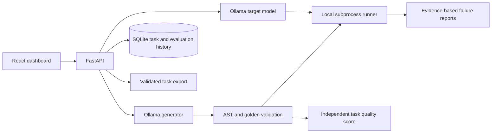

# ModelStump

ModelStump is a local-first MVP for generating Python programming benchmarks, validating their reference implementations, and evaluating a separately configured Ollama model. It prioritizes verified tasks over task volume.

## Current implementation

The backend supports structured task generation through Ollama, golden-solution validation, independent task quality scoring, target-model evaluation, classified failure summaries, SQLite task/evaluation history, recurring-weakness analysis, adaptive generation, public JSONL export, unauthenticated API access, and persistent pipeline-job status. Public API responses use allowlisted serializers; detailed validation and failure evidence remains in local records. The React dashboard currently displays analytics and task records and supports task generation.

Persistent dataset version management, LangGraph checkpointing, dashboard pages for evaluation/failure/adaptive workflows, and automatic pre/post-adaptation comparisons are not implemented. `/api/pipeline/run` is queued to a local thread pool and its status is stored in SQLite. Jobs interrupted by process restart are marked failed; they are not automatically resumed. Direct generation and evaluation endpoints remain synchronous.

## Architecture



Golden validation prevents an incorrect reference answer from being mistaken for a model failure. Hidden tests measure behavior beyond examples shown in a task. Task quality is measured separately from target model performance. Adaptive generation uses recurring failure labels observed across distinct tasks and applies diversity checks, but its behavior remains heuristic and requires model-backed evaluation for useful evidence. Generation and evaluation prompts, model names, task versions and stored test evidence provide a basis for reproducibility, but results are not guaranteed reproducible across hardware or model versions. Target prompts omit golden solutions, tests and expected outputs.

## Requirements and local setup (Windows PowerShell)

Install Python 3.11+, Node.js, and Ollama separately. No Docker or paid inference service is required. The repository currently has an `env` virtual environment; a fresh checkout can create `.venv` instead.

```powershell
cd D:\stump_AI
py -3.11 -m venv .venv
.\.venv\Scripts\Activate.ps1
python -m pip install -r requirements.txt
Copy-Item .env.example .env
ollama pull qwen3:4b
ollama pull qwen3:1.7b
```

Edit `.env` and set independently installed `GENERATOR_MODEL` and `TARGET_MODEL`. Set `EXECUTION_BACKEND=unsafe_subprocess` for trusted local development. Ollama must be running locally. Start the backend:

```powershell
uvicorn backend.main:app --reload
```

Open API docs at `http://localhost:8000/docs`. In a second terminal:

```powershell
cd D:\stump_AI\frontend
npm install
npm run dev
```

Open `http://localhost:5173`. Use **Generate task** to create and validate a task. A task is accepted only when golden validation and quality checks both pass. Evaluation requires a model name.

## API

| Endpoint | Purpose |
|---|---|
| `GET /api/health` | Service and configured model names |
| `POST /api/tasks/generate` | Generate, validate, score and store tasks |
| `POST /api/tasks/{task_id}/validate` | Re-run golden validation |
| `POST /api/tasks/{task_id}/evaluate` | Evaluate using configured or request target model |
| `GET /api/tasks`, `GET /api/tasks/{task_id}` | Browse stored tasks |
| `GET /api/evaluations`, `GET /api/evaluations/{evaluation_id}` | Browse stored evaluations |
| `GET /api/failures` | Safe failure-type and severity summaries |
| `GET /api/weaknesses` | Recurring weakness aggregates across distinct tasks |
| `GET /api/analytics` | Actual aggregate counts and rates |
| `GET /api/datasets`, `GET /api/datasets/export` | Dataset count and validated public-case JSONL export |
| `POST /api/pipeline/run`, `GET /api/jobs/{job_id}` | Queue a persistent local pipeline job and poll its status |
| `POST /api/jobs/{job_id}/cancel` | Cancel a job only if it has not started |
| `POST /api/adaptive-generation/run` | Generate from recurring failure evidence (409 when evidence is insufficient) |

SQLite stores versioned task JSON, evaluation records, and pipeline job status in `modelstump.db`. A safe additive migration adds nullable `task_version` to older evaluation rows; old records remain intact and retain a null version when it cannot be proven. Public JSONL export omits golden solutions, expected outputs, hidden tests, and metadata. Admins can explicitly request an internal solution-bearing export with `GET /api/datasets/export?include_solution=true`. Each export uses a timestamped new filename and does not overwrite earlier snapshots.

## Execution limitations

The configured execution backend is named `unsafe_subprocess`. It uses a temporary working directory, wall-clock timeout, output check, AST checks, and a reduced environment. It is **not a secure sandbox**. It does not restrict filesystem or network access, memory, process creation, or reliably terminate child process trees. There is no verified secure Windows backend in this project. The health response explicitly reports `secure: false`; do not use this application with untrusted candidate code or expose it to untrusted users. 

## Tests

Run core deterministic checks with:

```powershell
python -m pytest
```

These tests do not contact Ollama. Real model integration requires both configured models to be pulled and the Ollama service running. No mocked benchmark result is presented as a real evaluation. Pipeline jobs use two in-process worker threads and persist their result/status in SQLite; unfinished jobs are marked failed at restart rather than resumed.

## Future scope

Add LangGraph state/checkpoint orchestration, background jobs, independently derived expected outputs, mutation and property-based checks, lineage-aware adaptive generation, held-out datasets, duplicate detection, persistent dataset versions and the remaining dashboard pages. A later design can add terminal tasks or multimodal adapters without claiming those capabilities exist today.
